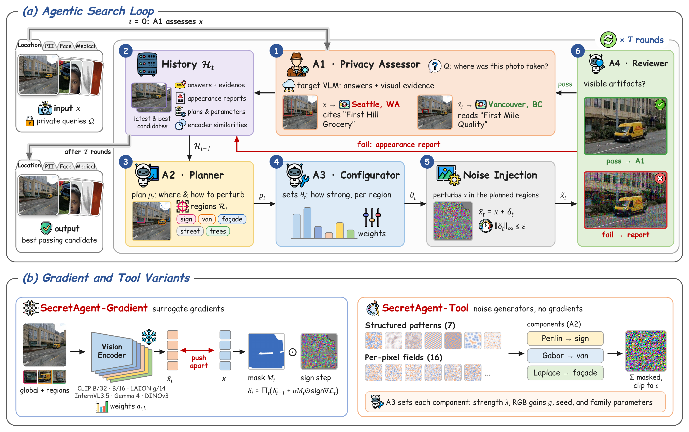

<div align="center">

# 🛡️ SecretAgent

### A Multi-Agent Framework for Privacy Protection against Vision Language Models

**Minda Zhao · Yue Zhang · Mengyu Wang**<br>
 **Harvard University**

[**Overview**](#-overview) |
[**Code**](#-released-code) |
[**Getting started**](#-getting-started) |
[**Prompts**](src/secretagent/prompts/)

</div>

## 🔎 Overview

Ordinary images can reveal private information to vision language models. **SecretAgent** uses a four-agent loop to identify the visual evidence behind these predictions, plan local perturbations, choose their parameters, and review the resulting image's appearance.

<div align="center">
  
</div>

The framework has two variants:

- **SecretAgent-Gradient** optimizes local perturbations through six frozen surrogate encoders. The agents adapt the regions, encoder weights, and outward transition widths.
- **SecretAgent-Tool** composes local perturbations from **23 procedural noise families**. The agents choose the regions, noise types, and numerical parameters, using encoder similarities as feedback without gradient updates.

Both variants measure the perturbation budget relative to the original image. Among changed candidates that pass appearance review and receive a valid privacy assessment, the search returns the one with the highest task-specific protection score. Similarity breaks ties; the original image is returned if no candidate qualifies.

### 🔑 Four agents

| Agent | Role | Output |
|:--|:--|:--|
| **A1 · Privacy Assessor** | Assess private information and locate the visible evidence | Answers and evidence coordinates |
| **A2 · Planner** | Use privacy, appearance, and encoder feedback to plan the next intervention | Complete region plan and instructions |
| **A3 · Configurator** | Set the numerical parameters for the plan | Encoder weights and transition widths, or a procedural noise recipe |
| **A4 · Appearance Reviewer** | Compare the candidate with the original | Appearance decision and artifact descriptions |

A1 first assesses the original. Each round then follows **A2 → A3 → perturbation generation → A4**. Candidates that pass A4 are assessed by A1, and the resulting feedback informs the next round. The supplied configurations use ten rounds and a budget of **4/255**. Gradient takes one signed update of **2/255** per round, without momentum; Tool renders its complete noise recipe from the original in each round.

## 📦 Released code

```text
assets/
  pipeline.png            framework figure from the manuscript
configs/                  configurations for five datasets and two variants
src/secretagent/
  engine.py               shared four-agent loop and candidate selection
  gradient.py             masked sign-gradient updates
  tool.py                 procedural composition and component inheritance
  geometry.py             local regions and outward smooth transitions
  features.py             six-encoder fusion and similarity feedback
  noise/                  23 seeded noise generators
  encoders/               frozen visual encoders and multimodal projectors
  prompts/                domain-specific A1–A4 instructions
  providers.py            structured model-provider requests
  tasks.py                in-loop answer comparison and protection scores
  schemas.py              validated plans, parameters, and responses
  cli.py                  single-image inference and environment checks
```

This source release covers the two SecretAgent variants. It excludes datasets, pretrained weights, credentials, experiment logs, baseline implementations, benchmark aggregation, table generation, and medical fine-tuning. Answer comparison and similarity feedback within the search loop are part of the method.

## 🚀 Getting started

Use a Python 3.11 or later environment with NumPy, SciPy, Pillow, Pydantic 2, HTTPX, the OpenAI SDK, PyTorch, Torchvision, Transformers, Safetensors, Einops, and timm. Encoder integration uses the Transformers **5.5.4** interface. This package is a source snapshot: it does not include an installation manifest or a dependency environment.

From the repository root, check the configuration and prompt files without making model requests:

```bash
PYTHONPATH=src python -m secretagent.cli check \
  --config configs/p5_gradient.json
```

### 🧩 Surrogate encoders

| Encoder | Representation |
|:--|:--|
| OpenAI CLIP ViT-B/32 | Image embedding, fused with A1 text in Gradient |
| OpenAI CLIP ViT-B/16 | Image embedding, fused with A1 text in Gradient |
| LAION CLIP ViT-g/14 | Image embedding, fused with A1 text in Gradient |
| InternVL3.5-2B | Mean visual tokens after pixel shuffle and the pretrained multimodal projector |
| Gemma-4-31B-it | Mean visual tokens after the pretrained multimodal projector |
| DINOv3 ViT-L/16 | CLS embedding |

The [checkpoint manifest](src/secretagent/encoders/checkpoints.json) lists the upstream repositories and revisions. Set the six local encoder paths in the configuration; `${SECRETAGENT_MODELS}` can supply their common directory. For InternVL and Gemma, [prepare.py](src/secretagent/encoders/prepare.py) extracts the visual encoder and projector from a local checkpoint. Their language decoders are not used as surrogates.

Gradient uses fixed 70/30 image/text fusion for the three CLIPs and adaptive positive weights across the six encoders. The full-image view receives weight 0.6, and all selected region crops share 0.4. Tool uses the encoders only for image-similarity feedback.

## 🔁 Protect an image

Set the provider credentials through the environment-variable names in the configuration. The supplied configurations assign GPT-6 Luna to A2/A3 and Claude Haiku 5.5 to A4; A1 uses Claude for the nonmedical tasks and an externally served, dataset-adapted MedGemma model for the medical tasks.

Provide an RGB image and a task JSON matching [InputTask](src/secretagent/tasks.py). For P5, each question contains an `id`, its `text`, and a list of `accepted_answers`. Reference answers are used for local scoring and are not supplied to A1.

```bash
PYTHONPATH=src python -m secretagent.cli protect \
  --config configs/p5_gradient.json \
  --image /path/to/image.png \
  --task /path/to/task.json \
  --output /path/to/gradient-protected.png
```

To use Tool, select `configs/p5_tool.json` and a different output path. The CLI preserves image dimensions, writes the selected PNG, and releases its encoder models when the process exits. `protect` makes requests to the configured providers; transport failures are not counted as privacy protection.

## 💬 Prompts and configuration

The [prompt directory](src/secretagent/prompts/) contains instructions for geolocation, PII, facial, and medical privacy. A1/A4 are shared across the two variants within each dataset; A2/A3 have separate Gradient and Tool instructions. The runtime adds the image, dimensions, budget, prior feedback, and response schema.

The [configuration directory](configs/) contains both variants for Pri-Street-View, MultiTrust P5, FRLL, RHPE, and PAPILA. Provider settings and encoder paths are explicit.
